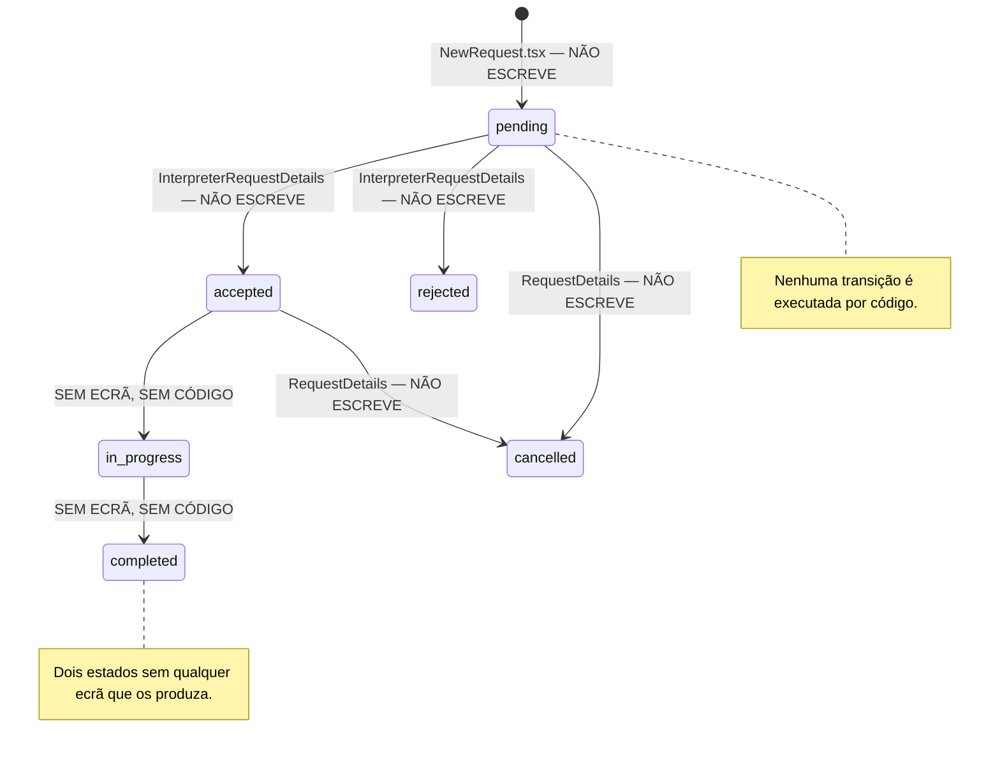

# 03 — Fluxos tal como estão implementados (Fase 3)

**Fonte:** ficheiros locais em `src/` e `supabase/`. Nenhuma execução da aplicação, nenhum acesso ao remoto.

Convenção: **[VISTO]** lido no código · **[INFERIDO]** deduzido · **[DESCONHECIDO]** não verificável.

> **Leitura obrigatória antes deste documento:** a aplicação tem **1 ecrã ligado à base de dados em 68** (`02-screens.md` §8) e **nenhum guard de rota** (`02-screens.md` §1). Os fluxos abaixo descrevem, portanto, duas coisas distintas que convém não confundar:
> - **o que o utilizador vê acontecer** — sequências de ecrãs completas, com confirmações;
> - **o que acontece na base de dados** — em 61 das 62 transições identificadas, nada.
>
> Cada passo é marcado com `→ BD: <tabela>` quando escreve, e `→ BD: nada` quando não.

---

## 1. Papéis de utilizador

### 1.1 Papéis que o schema e o código sugerem

| Papel | Evidência no schema | Evidência no código | Tem ecrãs? | Tem autenticação? |
|---|---|---|---|---|
| **Visitante** (anónimo) | — | `PublicRoutes.tsx` | ✅ 12 rotas | n/a |
| **Solicitante** | `requester_profiles`, `users.role` | `UserRole.REQUESTER = 'requester'` (`src/type/enum/identity.ts`) | ✅ 10 rotas | ❌ |
| **Intérprete** | `interpreter_profiles`, `users.role` | `UserRole.INTERPRETER = 'interpreter'` | ✅ 18 + 3 rotas | ❌ |
| **Administrador** | `admin_profiles.permission_level` | `UserRole.ADMIN = 'admin'` | ✅ 18 + 10 rotas | ❌ |
| **Parceiro** ⚠️ | `partnerships` + `opportunities.posted_by_partner_id` | **nenhuma** — não existe valor em `UserRole` | ❌ nenhuma rota | ❌ |

> ⚠️ **"Parceiro" é [INFERIDO] fraco — provavelmente não é um papel de utilizador.** [VISTO quanto às colunas] / [INFERIDO quanto à leitura]
>
> A leitura mais simples das colunas de `partnerships` é a de **um catálogo de descontos**, não a de um tipo de conta: `discount_percentage NUMERIC(5,2)`, `benefit_description`, `logo_url`, `website_url`, `contact_email`, `start_date`/`end_date` (`database_schema.sql:596-612`). Não há coluna de credenciais, nem ligação a `users`, nem perfil associado.
>
> Reforçam a leitura dois factos: a tabela só se liga ao módulo **"benefits"** (`AdminRoutes.tsx:128` — "Gestão de Parcerias", "Acompanhar e adicionar novas parcerias"), e é uma **ilha** — sem FK para fora e sem nenhuma tabela a apontar para ela.
>
> O único sinal em sentido contrário é o nome de `opportunities.posted_by_partner_id`. E essa coluna aponta para `users(id)`, **não** para `partnerships` (`:591`) — mais consistente com um nome mal escolhido do que com um papel real.
>
> O `product-explainer.md` §2 lista quatro utilizadores (visitante, solicitante, intérprete, equipa) e **não menciona parceiros**; o §7 coloca "Benefícios e parcerias" entre as áreas de conteúdo geridas pela equipa. **Tratar como entidade de conteúdo, não como papel**, até decisão em contrário (P10 em aberto).

### 1.2 Sub-papéis de administrador

`admin_profiles.permission_level` declara três níveis [VISTO] `database_schema.sql:48` e `src/type/enum/identity.ts`:

| Nível | `AdminPermissionLevel` | Onde é usado |
|---|---|---|
| Super administrador | `SUPER_ADMIN = 'super_admin'` | só para **mostrar um badge** (`AdminTeam.tsx:143-148`) e filtrar a lista (`:28-33`) |
| Moderador | `MODERATOR = 'moderator'` | idem (`:151-159`) |
| Gestor financeiro | `FINANCE = 'finance'` | idem (`:149-150`) |

**Nenhum dos três níveis controla acesso a nada.** Busca por `permission_level` em `src/pages/` e `src/routes/`: aparece apenas em `AdminTeam.tsx` (filtro e badge) e `TeamMemberModal.tsx` (campo do formulário). Um moderador e um gestor financeiro veem exactamente as mesmas 28 rotas de administração. [VISTO]

### 1.3 O papel do utilizador não é lido em nenhum ponto da aplicação

| O que seria esperado | Realidade |
|---|---|
| `users.role` lido para decidir o dashboard | **nunca lido.** `UserRole.*` aparece em apenas 2 lugares em todo o `src/`, ambos de **escrita**: `AdminTeam.tsx:115` e `TeamMemberModal.tsx:77` [VISTO] |
| `admin_profiles` consultado para autorizar | nunca, para autorização |
| Papel inferido da sessão | não há sessão (`00-overview.md` §5) |
| Papel no layout | hardcoded como literal (`02-screens.md` §1) |

**Como se escolhe o papel hoje:** escrevendo o URL. `/dashboard/requester`, `/dashboard/interpreter` ou `/dashboard/admin`. Não há nada entre o visitante e qualquer um dos três dashboards. [VISTO]

---

## 2. Jornada: Visitante

| # | Ecrã | Acção | Escrita | Ecrã seguinte |
|---|---|---|---|---|
| 1 | `/` | — | — | redirecciona para `/home` (`AppRoutes.tsx:20`) |
| 2 | `/home` | explorar | — | qualquer rota pública |
| 3 | `/interpreters` | filtrar e pesquisar (sobre `interpretersMocks`) | **→ BD: nada** | `/interpreters/:slug` |
| 4 | `/interpreters/:slug` | ver perfil completo | **→ BD: nada** | — |
| 5 | `/interpreters/:slug` | clicar "Solicitar serviço" → `RequestServiceModal` | **→ BD: nada** — mostra "Entraremos em contacto em breve" (`RequestServiceModal.tsx:85`) | fecha modal |
| 6 | `/contact` | submeter formulário de contacto | **→ BD: nada** — `// Simulate form submission` (`Contact.tsx:52`). **Não existe tabela de mensagens de contacto no schema** | ecrã de sucesso (`:139`) |
| 7 | `/register` | registar-se | **→ BD: nada** — `// Simulate registration` (`Register.tsx:29`) → `toast.info('…será implementado em breve.')` (`:32`) | permanece |
| 8 | `/login` | entrar | **→ BD: nada** — `setTimeout(1500)` → toast (`Login.tsx:19-21`) | permanece |

**O visitante não tem como se tornar utilizador.** A jornada de entrada na plataforma termina num toast. [VISTO]

**Caminho que de facto funciona:** escrever `/dashboard/requester` na barra de endereços. Entra-se no dashboard completo sem registo nem login. [VISTO]

---

## 3. Jornada: Solicitante

### 3.1 Criar um pedido — o fluxo central da plataforma

`NewRequest.tsx`, 544 linhas, 7 passos. [VISTO]

| Passo | Ecrã | Recolhe | Validação (`canProceed`, `:83-95`) |
|---|---|---|---|
| 1 | tipo de pedido | `requestType`: `direct` ou `open` | `!!requestType` |
| 2 | serviço (+ intérprete se directo) | `serviceType`, `selectedInterpreter` | `!!serviceType`, e se `direct` também `!!selectedInterpreter` |
| 3 | modalidade | `modality` | `!!modality` |
| 4 | data e hora | `date`, `time` | `!!date && !!time` — **não valida que seja futura** |
| 5 | local ou link | `location` / `meetingLink` | presença do campo certo conforme a modalidade — **não valida formato de URL** |
| 6 | duração | `duration` | `!!duration` — **não valida ser número positivo** |
| 7 | revisão | — | `return true` sempre |

**Acção final** [VISTO] `NewRequest.tsx:106-114`:

```
Passo 7 → "Confirmar"
  → toast.success("Solicitação direta/aberta criada com sucesso!")
  → navigate("/dashboard/requester/requests")
  → BD: nada
```

| O que deveria acontecer | O que acontece |
|---|---|
| `INSERT INTO bookings` com `status = 'pending'` | nada |
| `INSERT INTO booking_logs` (`old_status = NULL`, `new_status = 'pending'`) | nada |
| `INSERT INTO notifications` para o intérprete | nada |
| Pedido aparecer em `/dashboard/requester/requests` | a lista mostra 1 array hardcoded, onde o pedido não existe (`RequesterRequests.tsx`) |

`SupabaseBookingDAO`, `BookingUseCase` e `booking.viewmodel` existem completos e **nenhum é importado por este ecrã**. [VISTO]

### 3.2 Pedido directo vs. pedido aberto

O passo 1 bifurca o fluxo em dois tipos. **Nenhum dos dois é representável no schema.** [VISTO]

| Tipo | Modelação no schema | Problema |
|---|---|---|
| `direct` | `bookings.interpreter_profile_id` preenchido | ✅ possível |
| `open` | `bookings.interpreter_profile_id = NULL` (a coluna é nullable, `:251`) | ⚠️ possível, mas **não há coluna que distinga "aberto" de "directo ainda sem intérprete"**, nem tabela de candidaturas |

O ecrã `InterpreterOpenRequests.tsx` (360 linhas) mostra a bolsa de pedidos abertos e permite candidatar-se. **Não existe tabela de candidaturas** (`booking_applications` ou equivalente) em nenhum dos 37 objectos do schema. E o campo que decidiria se um intérprete recebe pedidos abertos, `accept_open_requests`, existe no tipo TypeScript (`src/type/database/identity.ts:55`) e **não existe na tabela** (`01-database.md` §5.2 B5). [VISTO]

### 3.3 Negociação de preço — entidade inteira sem tabela

`src/components/dashboard/RequestNegotiationChat.tsx` implementa um chat com propostas de preço. [VISTO]

| Acção | `ficheiro:linha` | Escrita |
|---|---|---|
| enviar mensagem | `:138-150` | `setMessages([...messages, message])` → **BD: nada** |
| enviar proposta de valor | `:154-179` | `setMessages(...)` + `toast.success("Proposta enviada!")` → **BD: nada** |
| aceitar proposta | `:184-196` | `setMessages(messages.map(...))` + toast → **BD: nada** |
| recusar proposta | `:202-211` | idem + `toast.info("Proposta recusada")` → **BD: nada** |

Os dados iniciais vêm de `mockMessages` (`:76`, consumido em `:129`).

**O schema não suporta esta funcionalidade.** `chat_messages` tem `content`, `attachment_url`, `attachment_type` — e **nenhuma coluna de valor proposto nem de estado de proposta**. `AdminRequestDetails.tsx:64-66` mostra um histórico de negociação hardcoded com `{ by, amount, status }`, uma forma de dados que não existe em nenhuma tabela. É uma entidade de negócio (proposta de preço) com interface, com histórico no ecrã de admin, e **sem qualquer representação no modelo de dados**. [VISTO]

### 3.4 Restantes acções do solicitante

| Ecrã | Acção | Escrita |
|---|---|---|
| `requests/:id` | cancelar pedido (`RequestDetails.tsx:102`) | **→ BD: nada**. O `CancelRequestModal.tsx` existe e é **órfão** — este handler não o usa (`02-screens.md` §12.2) |
| `interpreters` | marcar favorito | **→ BD: nada**. Tabela `favorites` e `SupabaseFavoriteDAO` existem, sem consumidor |
| `favorites` | remover favorito | **→ BD: nada** |
| `reviews` | avaliar intérprete | **→ BD: nada**. `ReviewInterpreterModal.tsx` é **órfão** |
| `profile` | guardar perfil (`RequesterProfile.tsx:29`) | **→ BD: nada** — `// Simulate API call` |
| `settings` | guardar preferências | **→ BD: nada**. E **não existe tabela de preferências de utilizador** no schema |

---

## 4. Jornada: Intérprete

### 4.1 Receber e responder a um pedido

| # | Ecrã | Acção | Escrita | Seguinte |
|---|---|---|---|---|
| 1 | `/dashboard/interpreter` | ver resumo | hardcoded | — |
| 2 | `requests` | ver pedidos recebidos | hardcoded | `requests/:id` |
| 3 | `requests/:id` | **Aceitar** (`InterpreterRequestDetails.tsx:43-44`) | **→ BD: nada** — `toast.success("Solicitação aceite com sucesso!")` | permanece |
| 4 | `requests/:id` | **Recusar** com motivo (`:48-49`) | **→ BD: nada** — `toast.success("Solicitação recusada")` | permanece |

O que faltaria em cada uma: `UPDATE bookings SET status = 'accepted'|'rejected'`, `INSERT INTO booking_logs`, `INSERT INTO notifications`. Nenhuma acontece. Os modais `AcceptRequestModal.tsx` e `RejectRequestModal.tsx` existem e não escrevem (`02-screens.md` §8 — nenhum dos 19 modais escreve, excepto `TeamMemberModal`). [VISTO]

### 4.2 Construir o perfil

As 6 sub-páginas de perfil têm CRUD completo em `useState` sobre mocks. Nenhuma persiste. [VISTO]

| Sub-página | Tabela que deveria escrever | DAO existente | Escreve? |
|---|---|---|---|
| `profile/overview` | `interpreter_profiles` | `SupabaseInterpreterProfileDAO` | ❌ |
| `profile/experience` | `interpreter_experiences`, `interpreter_education`, `interpreter_certifications` | 3 DAOs | ❌ |
| `profile/services` | `interpreter_services` | `SupabaseInterpreterServiceDAO` | ❌ |
| `profile/content` | `articles`, `interpreter_portfolios` | 2 DAOs | ❌ |
| `profile/reviews` | `reviews` (alternar `is_visible`) | `SupabaseReviewDAO` | ❌ |
| `profile/contact` | `users` (telefone), ou nada | `SupabaseUserDAO` | ❌ |

**Línguas e especialidades: sem via de acesso.** As tabelas `interpreter_languages` e `interpreter_specialties` **não têm DAO** (`01-database.md` §5.2 C), e nenhum ecrã as gere. Um intérprete não consegue declarar que línguas interpreta — a funcionalidade mais básica de um directório de intérpretes de Língua Gestual Angolana. Os tipos TypeScript tentam contorná-lo com `languages: string[]` e `specialty: string[]` em `InterpreterProfileProps` (`identity.ts:57-58`), campos que não existem na tabela. [VISTO]

### 4.3 Verificação do intérprete

| # | Ecrã | Acção | Escrita |
|---|---|---|---|
| 1 | `verification` | ver estado (`InterpreterVerification.tsx`, 421 linhas) | lê `mockRequestsForInterpreter` (`:46`), filtra em `:133` |
| 2 | `verification` | pedir verificação → `RequestVerificationModal` | **→ BD: nada** — `// Simulate API call` (`RequestVerificationModal.tsx:113`) |
| 3 | `documents` | carregar documento → `UploadDocumentModal` | **→ BD: nada**, e **nenhum ficheiro é enviado**: `SupabaseStorageDAO` existe e não é chamado por nenhum ecrã (`02-screens.md` §12.4) |

O fluxo de verificação é o que tem mais superfície de UI no projecto (421 + 852 + 402 + 336 = 2011 linhas em 4 ecrãs) e escreve zero. [VISTO]

### 4.4 Disponibilidade, ganhos, pagamentos

| Ecrã | Acção | Escrita | Nota |
|---|---|---|---|
| `availability` | definir grelha semanal | **→ BD: nada** — 1 toast | `interpreter_availabilities` suporta recorrência e excepções, sem CHECK que force uma das duas (`01-database.md` §2.4) |
| `earnings` | ver ganhos | hardcoded | `payouts` existe; nada a lê nem escreve |
| `schedule` | ver agenda | hardcoded | — |
| `settings` | preferências | **→ BD: nada** | sem tabela de preferências |

**Não existe fluxo de pagamento em nenhum sentido.** As tabelas `payments` e `payouts` existem, com DAOs, e nenhum ecrã lê ou escreve nelas. `AdminPayments.tsx` e `InterpreterEarnings.tsx` mostram arrays literais. Não há integração com nenhum provedor (`payments.method` sugere `credit_card`, `bank_transfer`, `multicaixa` — nenhum implementado). [VISTO]

---

## 5. Jornada: Administrador

### 5.1 O único fluxo completo da aplicação: gerir a equipa

É o único caminho ecrã → acção → escrita → mudança de estado → ecrã que existe de facto. [VISTO]

```
/dashboard/admin/team
  → "Adicionar Membro"                                    AdminTeam.tsx:79-82
  → TeamMemberModal abre
  → escolher utilizador no combobox
       ← LÊ users  (getAllUsers(undefined, 0, search, { role: 'admin' }))
                                                          TeamMemberModal.tsx:73-78
  → escolher permission_level, department, is_active
  → "Guardar"
  → handleSaveMember                                      AdminTeam.tsx:89-122
       → BD: INSERT admin_profiles (user_id, permission_level, department, is_active)   :105-110
       → BD: UPDATE users SET role = 'admin' WHERE id = user_id                          :113-116
  → setIsModalOpen(false)                                                                :118
  → React Query invalida AUTH/ADMIN keys → lista recarrega
```

Outras transições reais do mesmo ecrã:

```
"Editar"  → updateAdminProfile(id, { permission_level, department, is_active })   :93-100
"Alternar estado" → updateAdminProfile(id, { is_active: !is_active })             :126-131
                  → toast.success("Acesso de X activado/desactivado.")            :132-134
```

### 5.2 Este fluxo não é inicializável

O combobox de selecção de utilizador filtra por `{ role: UserRole.ADMIN }` [VISTO] `TeamMemberModal.tsx:77`. Ou seja, **só mostra utilizadores que já têm `role = 'admin'`**. Mas o objectivo do fluxo é precisamente atribuir `role = 'admin'` (`AdminTeam.tsx:113-116`).

Combinando com o trigger `handle_new_user`, que cria utilizadores com `role = NULL` (`01-database.md` §4.1):

| Passo | Resultado |
|---|---|
| utilizador registado | `users.role = NULL` |
| aparece no combobox do `TeamMemberModal`? | **não** — o filtro exige `role = 'admin'` |
| pode ser promovido a admin pela UI? | **não** |
| primeiro administrador da plataforma | só por `INSERT`/`UPDATE` manual na base de dados |

**O único fluxo funcional da aplicação é circular e não tem ponto de entrada.** [VISTO quanto ao código] / [INFERIDO quanto à consequência prática]

### 5.3 Restantes 17 rotas de administração

Todas lêem mocks ou hardcoded e nenhuma escreve [VISTO] (detalhe em `02-screens.md` §7):

| Ecrã | Acção com confirmação | Escrita |
|---|---|---|
| `interpreters` | aprovar / suspender / verificar (3 toasts) | **nada** |
| `interpreters/:id` | 2 acções | **nada** |
| `interpreter-verifications` | aprovar / rejeitar (3 toasts) | **nada** |
| `requesters`, `requesters/:id` | suspender (3 toasts) | **nada** |
| `requests` | 1 acção | **nada** |
| `requests/:id` | `handleStatusChange` → `toast.success("Status alterado para: X")` (`:99-100`) | **nada** |
| `testimonials` | aprovar / rejeitar (2 toasts) | **nada**; `testimonials.approved_at`/`approved_by_user_id` nunca escritos |
| `success-cases` | publicar (2 toasts) | **nada** |
| `services` | criar / editar / desactivar (3 toasts) | **nada** |
| `settings` | guardar configuração (1 toast) | **nada**; `SupabaseSystemConfigDAO` existe e não é usado |
| `verification-requests` | aprovar / rejeitar (3 toasts) | **nada** |
| `verification-history` | exportar → "O ficheiro será descarregado em breve." (`:107`) | **nada**; exportação não implementada |
| `audit` | só leitura | lê `mockLogs`; **nada escreve em `audit_logs`** |
| `payments`, `reports`, `overview` | só leitura | hardcoded |

### 5.4 Auditoria: tabela existe, nada a alimenta

`audit_logs` tem 19 colunas, índice, DAO, usecase, viewmodel e um ecrã (`AdminAudit.tsx`, 230 linhas). **Nenhuma operação da aplicação escreve nela** — incluindo as escritas reais de `AdminTeam.tsx`, que criam e alteram perfis de administrador sem deixar registo. [VISTO]

Mesmo que algo tentasse escrever, `ip_address`, `user_agent` e `session_id` são `NOT NULL` e um cliente de browser não tem acesso fiável ao seu próprio IP (`01-database.md` §2.9). O desenho da tabela pressupõe escrita do lado do servidor — e não há servidor: zero edge functions, zero RPC. [VISTO] / [INFERIDO]

---

## 6. Máquinas de estado

### 6.1 `bookings.status` — a máquina central

**Valores possíveis no schema** [VISTO] `database_schema.sql:253` (comentário; **sem CHECK**, qualquer texto é aceite):

`pending` · `accepted` · `rejected` · `completed` · `cancelled` · `in_progress`

**Default:** `'pending'` (`NOT NULL DEFAULT 'pending'`).

#### Que código faz cada transição

| De → Para | Quem deveria fazer | Código que o faz |
|---|---|---|
| (criação) → `pending` | `NewRequest.tsx` submit | **nenhum** — `:106-114` só faz toast + navigate |
| `pending` → `accepted` | intérprete aceita | **nenhum** — `InterpreterRequestDetails.tsx:43-44` só faz toast |
| `pending` → `rejected` | intérprete recusa | **nenhum** — `:48-49` só faz toast |
| `accepted` → `in_progress` | início do serviço | **nenhum** — nenhum ecrã tem esta acção |
| `in_progress` → `completed` | fim do serviço | **nenhum** — nenhum ecrã tem esta acção |
| qualquer → `cancelled` | solicitante cancela | **nenhum** — `RequestDetails.tsx:102` não escreve |
| qualquer → qualquer | admin força estado | **nenhum** — `AdminRequestDetails.tsx:99-100` só faz toast |



**Conclusão: a máquina de estados não existe em execução.** Todos os 6 valores são alcançáveis apenas por escrita manual na base de dados. Dois deles (`in_progress`, `completed`) não têm sequer ecrã ou botão que os pretenda produzir. [VISTO]

#### Transições que nenhum código faz, e que nenhum ecrã pretende fazer

| Transição | Situação |
|---|---|
| `accepted` → `in_progress` | **nenhum ecrã tem a acção "iniciar serviço"** |
| `in_progress` → `completed` | **nenhum ecrã tem a acção "concluir serviço"** |
| `rejected` → qualquer | sem reabertura |
| `completed` → `cancelled` | não impedido por nada (não há CHECK nem código) |
| qualquer → qualquer | **permitido pela base de dados**: `status` é `TEXT` sem CHECK (`01-database.md` §1) |

Consequências de `completed` nunca ser alcançável por código [INFERIDO]: nunca se cria uma `review` legítima (que exige `booking_id`), nunca se gera um `payment` nem um `payout`, e `interpreter_profiles.rating`/`review_count` ficam a zero para sempre (ver §7).

#### `booking_logs`: a auditoria de transições que nada escreve

A tabela existe precisamente para registar `old_status → new_status` com `changed_by_user_id` e `reason` (`01-database.md` §2.6). **Nenhum trigger a popula, nenhum código a insere.** Mesmo que as transições existissem, não ficariam registadas. [VISTO]

### 6.2 Cinco vocabulários incompatíveis para o mesmo estado

Nenhum ecrã importa o `BookingStatus` oficial — o único que coincide com o schema. Cada um redefine o seu. [VISTO]

| Fonte | `ficheiro:linha` | Valores |
|---|---|---|
| **Schema** | `database_schema.sql:253` | `pending`, `accepted`, `rejected`, `completed`, `cancelled`, `in_progress` |
| **`BookingStatus`** (oficial, **nunca importado por páginas**) | `src/type/enum/booking.ts` | idem ✅ |
| `RequestDetails.tsx` | `requester/RequestDetails.tsx:25` | `pending`, `approved`, `rejected`, `completed`, `canceled`, `in_progress`, `confirmed` |
| `AdminRequests.tsx` | `admin/AdminRequests.tsx:11` | **`pendente`, `confirmado`, `concluido`, `cancelado`** |
| `InterpreterRequestDetails.tsx` | `interpreter/InterpreterRequestDetails.tsx:14` | `pending`, `confirmed`, `in_progress`, `completed`, `canceled` |
| `StatusBadge` (componente de render) | `components/dashboard/StatusBadge.tsx:3-14` | `pending`, `approved`, `rejected`, `completed`, `canceled`, `in_progress`, `confirmed`, `active`, `inactive`, `verified`, `unverified` |

Divergências estruturais:

| Valor | Schema | `StatusBadge` | Efeito |
|---|---|---|---|
| `accepted` | ✅ | ❌ **ausente** | `StatusBadge` lança `TypeError` (ver `02-screens.md` §9) |
| `cancelled` | ✅ | ❌ (tem `canceled`, uma letra a menos) | idem |
| `approved` | ❌ | ✅ | valor que a BD nunca produzirá |
| `confirmed` | ❌ | ✅ | idem |
| `pendente`/`confirmado`/`concluido`/`cancelado` | ❌ | ❌ | vocabulário só de `AdminRequests.tsx` |

**O ponto crítico:** no dia em que `bookings.status = 'accepted'` chegar a qualquer lista, `StatusBadge.tsx:75` lê `config.className` de `undefined` e a página deixa de renderizar. Hoje não acontece porque os mocks usam o vocabulário do componente. [VISTO quanto ao código] / [INFERIDO quanto ao erro em runtime]

### 6.3 `documents.status` e `verification_requests.status`

**Schema** [VISTO] `:222`, `:234`: `pending` · `approved` · `rejected`. Default `'pending'` em ambas. Sem CHECK.

**Código** — os mocks de verificação definem três tipos diferentes [VISTO] `src/core/mocks/verificationMocks.ts:1-3`:

```ts
export type RequestStatus      = "pending" | "approved" | "rejected" | "expired"
export type VerificationStatus = "active" | "pending" | "expired" | "rejected" | "suspended"
export type HistoryStatus      = "approved" | "rejected" | "expired" | "suspended"
```

E `:11` declara `status: RequestStatus | VerificationStatus | HistoryStatus` — união de 7 valores distintos: `pending`, `approved`, `rejected`, `expired`, `active`, `suspended`.

| Valor usado no código | Existe no schema? |
|---|---|
| `pending`, `approved`, `rejected` | ✅ |
| **`expired`** | ❌ — não há coluna de validade nem valor previsto |
| **`active`** | ❌ |
| **`suspended`** | ❌ |

Três estados de verificação existem na UI (e nas estatísticas: `AdminVerificationRequests.tsx:204-207`, `AdminVerificationHistory.tsx:113-115`) e **não existem no modelo de dados**. Para `expired` faltaria uma data de expiração, que nenhuma das duas tabelas tem. [VISTO]

#### Transições

| De → Para | Código |
|---|---|
| (criação) → `pending` | **nenhum** — `RequestVerificationModal.tsx:113` simula |
| `pending` → `approved` | **nenhum** — toasts em `AdminVerificationRequests.tsx`, `AdminInterpreterVerifications.tsx` |
| `pending` → `rejected` | **nenhum** — idem |
| → `expired` | **impossível** — sem coluna de validade, sem job, sem código |
| → `suspended` | **impossível** — valor não previsto no schema |

Colunas que registariam o acto de revisão — `documents.reviewed_at`/`reviewed_by_user_id`, `verification_requests.reviewed_at`/`admin_reviewer_id`/`admin_notes` — **nunca são escritas** (`01-database.md` §7). [VISTO]

### 6.4 `interpreter_profiles.verified`

`BOOLEAN DEFAULT false` [VISTO] `:66`. É o resultado final de todo o fluxo de verificação (2011 linhas de UI em 4 ecrãs).

**Nenhum código o altera.** Busca por `verified` em escritas: nenhuma. Não há trigger que o derive de `verification_requests.status = 'approved'`. Fica `false` permanentemente. [VISTO]

Consequência: o selo "Verificado" que o portal público mostra nos perfis de intérprete (`portal/InterpreterProfile.tsx`) viria sempre a `false` com dados reais — ou seja, nenhum intérprete apareceria como verificado, por muitas aprovações que o admin registasse. [INFERIDO]

### 6.5 Outras entidades com estado

| Tabela | Coluna | Valores no schema | Default | Código que transita |
|---|---|---|---|---|
| `payments` | `status` | `pending`, `completed`, `failed`, `refunded` | **sem default** | **nenhum** |
| `payouts` | `status` | `pending`, `processing`, `completed`, `failed` | **sem default** | **nenhum** |
| `articles` | `status` | `draft`, `published`, `archived` | **sem default** | **nenhum** |
| `events` | `status` | `draft`, `published`, `cancelled`, `completed` | **sem default** | **nenhum** |
| `opportunities` | `status` | `draft`, `open`, `closed`, `filled` | **sem default** | **nenhum** |
| `support_tickets` | `status` | `open`, `in_progress`, `waiting_user`, `resolved`, `closed` | **sem default** | **nenhum** |
| `testimonials` | `status` | `pending`, `approved`, `rejected` | **sem default** | **nenhum** (os toasts de `AdminTestimonials.tsx` não escrevem) |
| `success_cases` | `is_published` | boolean | `false` | **nenhum** |
| `legal_resources` | `is_published` | boolean | `false` | **nenhum** |
| `forum_topics` | `is_locked`, `is_pinned` | boolean | `false` | **nenhum** |
| `admin_profiles` | `is_active` | boolean | `true` | ✅ **`AdminTeam.tsx:126-131`** — a única transição de estado executada em toda a aplicação |
| `interpreter_profiles` | `is_active` | boolean | `true` | **nenhum** |
| `requester_profiles` | `is_active` | boolean | `true` | **nenhum** |

**Contagem final: de 62 transições de estado identificadas no schema e na UI, exactamente 1 é executada por código** — `admin_profiles.is_active`, em `AdminTeam.tsx`. [VISTO]

As 7 colunas `status` com `NOT NULL` e **sem default** merecem nota: qualquer `INSERT` que omita o `status` falha. Como o `BaseSupabaseDAO.create()` envia apenas as colunas presentes no objecto recebido (`BaseSupabaseDAO.ts:115-124`), um `create()` nessas tabelas sem `status` explícito dá erro de NOT NULL. Nenhum código o faz hoje. [VISTO] / [INFERIDO]

---

## 7. Onde o fluxo parte

### 7.1 Ecrã sem backend

**61 das 62 escritas pretendidas não chegam à base de dados.** [VISTO] Os casos mais consequentes:

| Ecrã | Linhas | Acção pretendida | `ficheiro:linha` |
|---|---|---|---|
| `NewRequest.tsx` | 544 | criar pedido — **o fluxo central do produto** | `:106-114` |
| `AdminVerificationRequests.tsx` | 852 | aprovar/rejeitar verificações | 3 toasts |
| `InterpreterVerification.tsx` | 421 | pedir verificação | `RequestVerificationModal.tsx:113` |
| `AdminInterpreterVerifications.tsx` | 402 | moderar intérpretes | 3 toasts |
| `InterpreterOpenRequests.tsx` | 360 | candidatar-se a pedido aberto | 2 toasts |
| `AdminRequestDetails.tsx` | 347 | mudar estado de pedido | `:99-100` |
| `AdminVerificationHistory.tsx` | 336 | exportar histórico | `:107` |
| `RequestNegotiationChat.tsx` | — | negociar preço | `:138-215` |
| `RequesterProfile.tsx` | 167 | guardar perfil | `:29` |
| `Login` / `Register` / `RecoverPassword` | 531 | **autenticar-se** | `Login.tsx:19-21`, `Register.tsx:29-32`, `RecoverPassword.tsx:17` |
| `Contact.tsx` | 214 | enviar mensagem | `:52` |
| 18 dos 19 modais | — | todas as acções | `02-screens.md` §8 |

### 7.2 Tabela ou coluna sem ecrã

| Tabela | Situação | Rota correspondente |
|---|---|---|
| `interpreter_languages` | **sem DAO e sem ecrã** | nenhuma |
| `interpreter_specialties` | **sem DAO e sem ecrã** | nenhuma |
| `booking_logs` | DAO, índice, e nada escreve nem lê | nenhuma |
| `forum_topics`, `forum_posts` | DAOs completos | `modules/forum` = `ModulePlaceholder` |
| `legal_resources` | DAO | `legal`, `modules/legal` = `ModulePlaceholder` |
| `opportunities` | DAO | `opportunities`, `modules/opportunities` = `ModulePlaceholder` |
| `partnerships` | DAO; **ilha sem FK** | `modules/benefits` = `ModulePlaceholder` |
| `events` | DAO | `events`, `modules/events` = `ModulePlaceholder` |
| `support_tickets` | DAO | `modules/support` = `ModulePlaceholder` |
| `notifications` | DAO | **nenhuma rota** |
| `system_configs` | DAO | `AdminSettings` existe e não o usa |
| `payments`, `payouts` | DAOs | ecrãs existem com dados hardcoded |

**Colunas sem ecrã que as produza** [VISTO]:
- `interpreter_profiles.verified` — resultado de 2011 linhas de UI de verificação; nada o escreve
- `interpreter_profiles.rating`, `.review_count` — nada os calcula
- `documents.reviewed_at`, `.reviewed_by_user_id`, `.admin_notes`
- `verification_requests.reviewed_at`, `.admin_reviewer_id`, `.admin_notes`, `.payment_id`, `.amount`
- `testimonials.approved_at`, `.approved_by_user_id`
- `articles.view_count`, `forum_topics.post_count`/`.last_post_at`, `forum_posts.like_count`, `events.registered_count`
- `chat_messages.read_at` — nenhum ecrã marca mensagens como lidas
- `users.role` — escrito só em `AdminTeam.tsx:115`; **nunca lido**

### 7.3 Entidades com ecrã e sem tabela

O inverso: funcionalidades com interface e sem modelo de dados. [VISTO]

| Entidade | Onde aparece na UI | Tabela |
|---|---|---|
| **Proposta de preço / negociação** | `RequestNegotiationChat.tsx:154-215`, histórico em `AdminRequestDetails.tsx:64-66` | **não existe** |
| **Candidatura a pedido aberto** | `InterpreterOpenRequests.tsx` (360 linhas) | **não existe** |
| **Mensagem de contacto** | `Contact.tsx` | **não existe** |
| **Preferências de notificação** | `RequesterSettings.tsx`, `InterpreterSettings.tsx` | **não existe** |
| **Inscrição em evento** | `events.registered_count` pressupõe-a | **não existe** |
| **Like em post de fórum** | `forum_posts.like_count` pressupõe-o | **não existe** |
| **Validade de verificação** (`expired`) | `verificationMocks.ts:1-3`, estatísticas dos ecrãs de admin | **não existe coluna de validade** |
| **Suspensão** (`suspended`) | `verificationMocks.ts:2`, `UserSuspensionModal.tsx` | **não existe valor nem coluna** |
| **Tutoriais** | `/tutorials` (`portalMocks`) | **não existe** |

### 7.4 Policies RLS que bloqueariam ou permitiriam demasiado

**[DESCONHECIDO — remoto inacessível].**

O estado de RLS, policies e grants no projecto `mfobqukllkxuimcjiqvn` não foi verificável (`00-overview.md` §9, `01-database.md` §10). No snapshot local há **0 RLS e 0 policies** em 37 tabelas.

O que se pode dizer com a informação disponível:

#### Se o remoto não tiver RLS (cenário A de `01-database.md` §10)

Nada bloquearia nenhum fluxo — e tudo estaria aberto a qualquer portador da `anon key`, que vai no bundle do browser. Como **não há guards de rota nem autenticação**, a aplicação está hoje consistente com esse cenário: funciona como se não houvesse controlo de acesso em nenhuma camada. Se os ecrãs fossem ligados aos DAOs tal como estão, qualquer visitante anónimo em `/dashboard/admin/team` conseguiria criar administradores. [INFERIDO]

#### Se o remoto tiver RLS (cenário B)

**Praticamente todos os fluxos quebrariam**, porque a aplicação nunca autentica ninguém: todas as queries sairiam como `anon`, sem `auth.uid()`. Qualquer policy do tipo `USING (auth.uid() = user_id)` devolveria zero linhas.

O ponto concreto, verificável hoje: `AdminTeam.tsx` é o único ecrã com dados reais, e lê `admin_profiles` e escreve em `admin_profiles` e `users` **sem sessão**. Com RLS activo e qualquer policy razoável, esse ecrã mostraria lista vazia (e, por `:65`, sem distinguir erro de vazio, pois `isError` não é tratado — `02-screens.md` §8). Que hoje funcione ou não é **[DESCONHECIDO]**; se funciona, isso é em si um indício de ausência de RLS. [INFERIDO]

#### Policy que permitiria ler/escrever mais do que devia

Não avaliável sem o remoto. O que é avaliável é que **não existe nenhuma camada de autorização no cliente**: sem guards, sem leitura de `users.role`, sem uso de `admin_profiles.permission_level`, a totalidade do controlo de acesso desta aplicação depende de policies RLS que não estão versionadas e cujo estado é desconhecido. [VISTO quanto à ausência no cliente] / [DESCONHECIDO quanto ao servidor]

> **Nota sobre a condição de paragem definida para esta tarefa:** foi estabelecido parar se a secção "Exposição" mostrasse leitura ou escrita anónima em tabelas com dados. A condição **não é avaliável** — nem a exposição nem as contagens são conhecidas. Não houve paragem, e isso não significa ausência de exposição, apenas ausência de informação.

---

## 8. Resumo: o fluxo que existe e o fluxo que falta

| Dimensão | Estado |
|---|---|
| Papéis de utilizador com evidência firme | **4** — visitante, solicitante, intérprete, administrador |
| "Parceiro" | **[INFERIDO] fraco, provavelmente não é um papel.** `partnerships` parece um catálogo de descontos (`discount_percentage`, `benefit_description`), só se liga ao módulo "benefits", e o `product-explainer.md` §2 não o lista como utilizador. Ver §1.1 |
| Sub-papéis de admin | 3 níveis, nenhum com efeito em autorização |
| Como se escolhe o papel | **escrevendo o URL** |
| Jornadas de utilizador completas até à BD | **1** — gestão de equipa do admin |
| Essa jornada é inicializável? | **não** — o combobox só mostra quem já é admin (§5.2) |
| Transições de estado executadas por código | **1 de 62** — `admin_profiles.is_active` |
| Vocabulários de estado de pedido | **5 incompatíveis**, e o único correcto nunca é importado |
| Entidades com UI e sem tabela | 9 |
| Tabelas sem ecrã | 12 (2 delas sem DAO) |
| Autenticação | inexistente em runtime |
| Autorização no cliente | inexistente |
| Autorização no servidor (RLS) | **[DESCONHECIDO]** |

---

## 9. O que não foi verificado nesta fase e porquê

| Item | Razão |
|---|---|
| Se as transições ocorrem em runtime | a aplicação não foi executada (tarefa só de leitura) |
| Se `StatusBadge` lança de facto o `TypeError` com `accepted` | [INFERIDO] do código; exige execução com dados reais |
| Qual o estado real das tabelas com estado | nenhuma leitura de dados; contagens desconhecidas |
| Se o RLS bloquearia ou permitiria cada fluxo | **remoto inacessível** (`00-overview.md` §9) |
| Se `AdminTeam.tsx` funciona hoje contra o remoto | mesma razão |
| Se existem triggers de negócio no remoto (que mantivessem `rating`, `booking_logs`, etc.) | mesma razão — localmente não existem |
| Fluxos de pagamento com provedor real | nenhuma integração existe no código |
